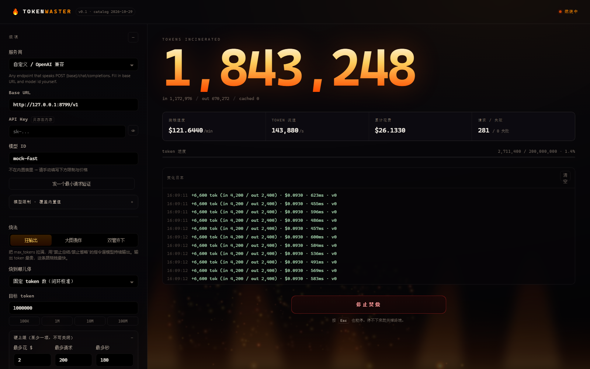

# 🔥 token-waster

> 一个故意烧掉你自己 LLM token 的工具。
> 并发、满上下文、满输出、绕开缓存、塞大图 —— 烧完给你一张账单。
> **它不产出任何东西。所有模型输出都会被立刻丢弃。**

<p align="center">
  
</p>

---

## ⚠️ 先读这个

这不是 AI 工具。它没有用途，只有成本。

| | |
|---|---|
| **花的是谁的钱** | 你自己的。你得自备 API key，费用从你自己的账单扣。 |
| **会不会有产出** | 不会。一个 token 都不会留下来。 |
| **key 存哪** | 只在这个 Node 进程的内存里。不写盘、不写日志、不上传。关掉就没了。 |
| **会不会失控** | 启动前强制要求设硬上限（金额 / token / 请求数 / 时长，至少一项），达到立即熔断。**这个开关无法关闭。** |
| **能不能乱用** | 不要用它绕过任何服务商的配额或条款。部分厂商禁止自动化滥用行为，被封号是你自己的事。 |
| **作者负责吗** | 不负责。MIT License，无任何担保。 |

如果你只是想"试试看"，请直接关掉这个页面。这个项目不需要被试用。

---

## 它是什么

一个**压力发生器**。你告诉它用哪个模型、烧到多少、能花多少钱，它就开始：

- 用 N 个并发 worker 持续发请求，每个请求都把 `max_tokens` 顶到模型上限
- 把输入填到上下文的指定比例（填充文本是随机生成的，没有语义）
- 需要时塞入多张大尺寸图片
- 每个请求都换一套随机前缀，**确保不会命中服务商的 prompt cache**
- 实时显示 token 数、烧钱速度、请求数和失败率
- 到达上限或你按下停止键，立刻掐断所有在途请求

关掉页面它还在跑（服务端在跑），刷新页面能重新接上。

## 它不是什么

- 不是 benchmark。它不测延迟、不测质量、不比较模型能力。
- 不是压测工具。压测关心吞吐和错误率，这里只关心账单。
- 不是"省钱"工具。方向完全相反。
- 不是一个能跑在服务器上给人用的服务。它只监听 `127.0.0.1`，因为它的设计前提是"操作者就是 key 的所有者"。

---

## 快速开始

需要 Node.js ≥ 20。**零依赖**，没有 npm install 步骤。

```bash
git clone <this-repo>
cd token-waster
node server.js
```

打开 http://127.0.0.1:8791

步骤：

1. 读完声明，勾选，输入 `WASTE`
2. 选服务商 → 填 API key → 确认模型 ID
3. 点「发一个最小请求验证」——这一步只花几十个 token，用来确认 key、端点、模型名都对
4. 设目标（比如 100 万 token）和硬上限（比如 $2 / 200 请求 / 180 秒）
5. 勾选确认，输入 `WASTE`，点火

想先空跑一遍看估算、不花一分钱：把 `dryRun` 打开（API 层，界面暂未暴露）。

```bash
curl -s localhost:8791/api/run/start -H 'content-type: application/json' -d '{
  "providerId":"openai","baseUrl":"https://api.openai.com/v1","apiKey":"sk-...",
  "modelId":"gpt-5.6-luna","strategy":"max-output","mode":"tokens","targetValue":100000,
  "concurrency":2,"confirm":"WASTE","dryRun":true,
  "guards":{"maxUsd":0.5,"maxRequests":20,"maxDurationSec":60}
}'
```

---

## 四种烧法

| 策略 | 做什么 | 适合 |
|---|---|---|
| **狂输出** `max-output` | 输入填 25% 上下文，`max_tokens` 拉满，用"禁止总结、禁止省略、写到你被掐断为止"的指令逼模型持续吐字 | 烧钱最快。输出 token 单价通常是输入的 4–8 倍 |
| **大图轰炸** `image-bomb` | 每请求塞多张大图，输入几乎全给图片，输出只要一个词 | 测视觉通道的计费；输入 token 单价低但量大 |
| **双管齐下** `mixed` | 图文一起上，剩下的全让模型写完 | 单请求 token 数最大化 |
| **固定 token 数** | 任意策略 + `mode: tokens`，引擎按剩余额度反向分配每个请求的配额，跑完做闭环校准 | 想要"刚好烧掉 500 万"这种可复现的数字 |

---

## 三个让它"效率很高"的技巧

这部分是这个项目唯一有点技术含量的地方。

### 1. 缓存穿透：让每一次请求都按全价计费

所有主流厂商的 prompt cache 都是**前缀匹配**的：

- **OpenAI**：≥1024 token 的 prompt 自动缓存，用前 ~256 token 的哈希决定路由到哪台机器
- **Anthropic**：只有显式打了 `cache_control` 标记的块才缓存 —— 本项目从不打，天然全 miss
- **Gemini / DeepSeek / 智谱**：隐式前缀缓存，同样是前缀命中

所以每个请求的**最前面**都放了 ~350 token 的 CSPRNG 随机串。前缀不同 → 哈希不同 → 路由到不同缓存分片 → 100% miss。

代价是每次都要传一份没用的前缀。收益是：**没有任何一个 token 按缓存价（通常 10%–25%）结算**。

> 顺带一个反直觉的结论：**多轮对话反而更省钱**。第二轮的前缀和第一轮相同，缓存直接命中，后续输入按 1/10 计价。所以这个工具刻意让每个请求都是独立的新对话。

### 2. 低熵大图：按像素计费，按字节上传

视觉计费看的是**像素数**，不是文件大小。一张 1536×1536 的纯色块 PNG 可能只有 60 KB，但和一张 3 MB 的照片计一样的钱。

所以图片生成器（`src/images.js`，手写 PNG 编码器，没有 canvas 依赖）用大色块 + `Up` 滤波，让压缩率极高而分辨率不变：

| 厂商 | 图片计费规则 | 1536² 一张大约 |
|---|---|---|
| Anthropic | 长边缩到 1568 后，≈ 像素 / 750 | ≈ 3,200 token |
| OpenAI | 缩进 2048/768 后按 512px 切块，85 + 170×块数 | ≈ 1,100 token |
| Gemini | 384px 切块，约 258 token/块（**不缩图**） | ≈ 4,100 token |

注意 Anthropic 会把长边压到 1568 —— 传更大的图只是多花上传时间，不多计费。Gemini 相反，分辨率越大越贵，所以它对「图片轰炸」的性价比最好。

### 3. 闭环配额：并发下也不会超支

N 个 worker 同时跑的时候，"我是不是已经花到 $5 了"没法事后才知道 —— 等请求回来再记账，已经超了。

所以每个请求发出**之前**先预扣一笔估算（token 和金额各一份），拿到真实 `usage` 之后再结算差额：

```
reserved = estimate(request)              // 发之前先扣
on response:
  reserved -= estimate
  spent    += actual_from_usage
```

预扣带 5% token / 15% 金额的安全边际。超过上限时，worker 不是立刻退出，而是等一轮结算 —— 因为"没额度"往往只是被在途请求占着，不是真的用完。

**精度**：`mode: tokens` 下，实测能在目标值 ±5% 内收敛（差额来自最后一个请求的实际输出可能小于 `max_tokens`）。

---

## 支持的服务商

全部走三家协议：OpenAI Chat Completions / Anthropic Messages / Gemini generateContent。所以新增一家基本是改数据不是改代码。

| 服务商 | 协议 | 内置模型示例 | 上下文 | 最大输出 | 备注 |
|---|---|---|---|---|---|
| OpenAI | openai-chat | `gpt-5.6-sol` / `terra` / `luna` | 1,050,000 | 128,000 | 自动前缀缓存，随机头有效 |
| Anthropic | anthropic-messages | `claude-sonnet-5-5` | 1,000,000 | 128,000 | 图片长边压到 1568；单请求最多 600 张 |
| Google Gemini | gemini-generate | `gemini-3-pro-preview` | 1,048,576 | 65,536 | 图片不缩图，大图真的更贵 |
| DeepSeek | openai-chat | `deepseek-v4-pro` | 1,000,000 | 384,000 | 价格有峰谷；输出上限极大 |
| Moonshot / Kimi | openai-chat | `kimi-k3` | 1,000,000 | 128,000 | |
| 智谱 GLM | openai-chat | `glm-5.3` | 1,000,000 | 128,000 | 强制思考，思考 token 按输出计 |
| 阿里云百炼 | openai-chat | `qwen3.8-max`、`qwen-long` | 1M / **10M** | 65,536 | `qwen-long` 是这里最大的窗口 |
| 火山方舟 / 豆包 | openai-chat | `doubao-seed-2.1-pro` | 256,000 | 32,768 | 也接受 endpoint id (`ep-xxx`) |
| MiniMax / xAI / Groq / Mistral | openai-chat | — | — | — | 内置值仅供参考 |
| OpenRouter | openai-chat | 任意上游模型 | 取决于上游 | 取决于上游 | 一把 key 打所有模型 |
| 硅基流动 | openai-chat | 聚合 | — | — | 部分模型免费 |
| Azure OpenAI | azure-openai | 你的 deployment 名 | — | — | `modelId` 填部署名 |
| 本地 Ollama | openai-chat | `qwen3:8b` | — | — | 不花钱，只烧电；适合先验证整条链路 |

> **价格与限制表核对于 2026-10-29，一定会过时。** 内置值只是起点，界面上每个字段都能改。引擎只信 API 返回的 `usage`，不信我们写的价格表。真要花钱前，去控制台核一遍。

---

## 安全护栏

不是"建议"，是代码里写死的：

1. **拒绝无上限的运行** —— 四个上限（token / 金额 / 请求数 / 时长）全为 0 时，直接 400 拒绝启动。
2. **并发硬顶 32**，单次运行金额硬顶 $500，请求数硬顶 20000，时长硬顶 6 小时。
3. **`127.0.0.1` only** —— 不监听外网地址。
4. **拒绝跨源请求** —— 检查 `Origin`，且所有写操作要求 `Content-Type: application/json`（触发预检，而我们不给 CORS 头）。
5. **明文 http 只允许指向本机** —— 公网端点必须 https，否则不接（防止把 key 发到明文通道）。
6. **key 不进日志** —— 错误信息只保留 HTTP 状态和响应体片段，不带请求头。
7. **急停** —— 所有在途请求共享一个 `AbortController`，`Esc` 或停止按钮 100ms 内生效。
8. **限流自动退避** —— 撞 429 时全局退避并按指数增长，不会硬冲把你的配额打穿。

---

## 已知限制

诚实地说：

- **金额上限是估算**。预扣用价格表算，实际以 `usage` 为准。如果价格表过时或图片 token 估低了，可能超出上限几个百分点（一个并发批次的量）。所以别把上限设成你钱包的极限。
- **输出 token 无法精确控制**。`max_tokens` 是上限不是下限，模型可能提前收工。`mode: tokens` 用闭环补偿，但最后一个请求仍可能差几个百分点。
- **有些模型会拒绝执行**。"无限输出整数"这类指令偶尔会被安全策略或指令遵循能力打断，表现为输出远小于 `max_tokens`。换模型或换策略。
- **参数集靠回退猜**。所谓"OpenAI 兼容"从字节级代理到严格校验都有。第一次接新厂商时，前几个请求可能在试错（日志里 `v0`、`v1` 就是试到第几个变体）。另外，如果服务商说"max_tokens 太大"或"上下文超了"，引擎会自动把对应数字减半重试，而不是一路失败到底。
- **不支持 Responses API**。统一的入口是 Chat Completions；后续可能加。
- **多轮上下文没做**。原因见上文：多轮会命中缓存，反而不浪费。

---

## 结构

```
server.js              HTTP 服务、参数校验、SSE 推送（零依赖）
src/
  config.js            服务商目录：协议、端点、上下文、输出上限、价格
  engine.js            调度器：并发池、预扣账本、闭环配额、熔断、急停
  prompts.js           随机填充文本 + 强制长输出指令 + 缓存穿透 nonce
  images.js            手写 PNG 编码器（zlib + CRC32），低熵大图
  protocols/
    index.js           协议分发
    http.js            POST / SSE 解析 / 错误分类
    openai.js          Chat Completions + 参数变体回退
    anthropic.js       Messages + thinking budget
    gemini.js          generateContent + 安全阈值
public/                原生 HTML/CSS/JS，无构建步骤
scripts/selftest.js    15 个离线测试（含 mock 厂商，覆盖三种协议）
```

没有框架，没有 bundler，没有 `node_modules`。

## 自测

```bash
node scripts/selftest.js
```

起一个模拟三种协议的本地服务，然后用真实引擎去打它，验证：使用量统计、配额收敛、金额熔断、请求数熔断、急停、图片体积、前缀随机性。

```
  ✓ PNG has valid signature and IHDR
  ✓ a big flat image stays small on disk
  ✓ image pool yields distinct images
  ✓ image token estimates are per-protocol
  ✓ filler hits its token target within 10%
  ✓ nonces never repeat
  ✓ payload head is random across calls (cache busting)
  ✓ cost estimate uses per-1M pricing
  ✓ engine converges on a token target
  ✓ money ceiling is respected within one in-flight wave
  ✓ request cap stops the run
  ✓ stop() halts in-flight workers
  ✓ anthropic protocol parses usage
  ✓ gemini protocol parses usage
  ✓ oversized max_tokens is adapted, not retried forever
  ✓ dry run sends nothing and reports a plan
```

## 路线图

- [ ] Responses API 适配器
- [ ] 多 key 轮询（用来打穿单 key 的 RPM）
- [ ] 音频/视频输入（Gemini 的音频按时长计费，比图片更"划算"）
- [ ] 导出本次运行的 JSON 报告（给社媒做图表）
- [ ] 英文界面

## License

MIT。随你怎么用，别来找我要钱。
